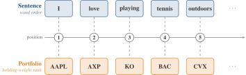
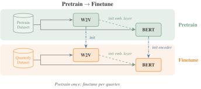

# AssetEmbeddingsInChina

> Learning asset embeddings from partial institutional holdings in China's A-share market.
> Companion code for the working paper "Do Asset Embeddings Need Complete Holdings? Lessons from China" (2026).

[](LICENSE)
[](pyproject.toml)
[](https://doi.org/10.5281/zenodo.20640781)
[](https://colab.research.google.com/github/Initial-Singularity/AssetEmbeddingsInChina/blob/main/examples/quickstart.ipynb)

## The setting

China's A-share market is institutionally distinct: retail investors dominate trading volume, institutional holdings account for only ~20% of floating shares, and the disclosure regime alternates between fully observed (semi-annual / annual) and partially observed (quarterly top-10) panels. Asset characteristics shift on quarterly horizons under industrial-policy and regulatory cycles. Whether asset embeddings need complete holdings to work, or whether the partial panels China actually discloses are enough, is the question the companion paper answers; this repository provides the code that learns and evaluates the embeddings.

Following Gabaix et al. (2025), we extract latent asset characteristics from institutional holdings: each investor's portfolio is a *sentence* and each stock is a *token*. Rank order carries economic meaning — the largest position is the primary exposure, smaller positions are supplementary — just as word order carries meaning in language.

<p align="center">
  
</p>

## What's new methodologically

Gabaix et al. estimate each quarter's embedding from that quarter's holdings alone. We depart from them in two ways.

**Pretrain once, finetune every quarter.** In the demand system $h_{i,a,t} = \lambda_i^\top x_{a,t} + \delta_i + \delta_a + \epsilon_{i,a,t}$, the embedding is identified only up to a rotation: $\Gamma x_{a,t}$ fits the holdings as well as $x_{a,t}$ once $\lambda_i$ becomes $(\Gamma^{-1})^\top \lambda_i$. Quarters estimated separately therefore need not share a coordinate frame, and $x_{a,t+1} - x_{a,t}$ can record a change of axes rather than a change in the asset. We pretrain Word2Vec and BERT once on the holdings up to a cutoff quarter (the first 80 % of holding observations, through 2023Q1) and start the estimation of every later quarter (2023Q2–2024Q3) from that shared base, finetuning it on the quarter's holdings. Pretraining learns the holding structure common to all quarters; finetuning adds what is specific to each one. The recommender system has no iterative parameters to initialize and is estimated quarter by quarter.

**Warm start.** BERT's embedding layer starts from the trained Word2Vec embedding, at pretraining and at every finetune, instead of from random vectors. Word2Vec already places assets with similar co-holdings close together, so BERT refines a sensible geometry rather than first rediscovering it. This matters most for the assets that appear in only a handful of portfolios in the top-10-only Q1/Q3 quarters.

**What pretraining changes.** Without pretraining, adjacent quarters are as far apart in orientation as a random rotation would leave them, and an asset keeps about one of its 25 nearest neighbors from one quarter to the next. With pretraining, the frames stay close, a single rotation removes at most about 7 % of the quarter-to-quarter movement, and between one in twelve and one in four neighbors persist, more at higher dimensions (Appendix C of the paper). On the benchmarks, BERT scores lower on all three without pretraining, and managed portfolios fall most without the quarterly finetune (Section 5).

<p align="center">
  
</p>

## What the repository provides

- **Three model families** trained on institutional portfolios: `AssetBERT` (transformer MLM), `AssetW2V` (Skip-gram/CBOW), and `AssetRS` (recommender-system baselines).
- **The pretrain–finetune pipeline** with the Word2Vec warm start, producing quarterly embedding sequences that are comparable over time.
- **The evaluation code** for the paper's benchmarks: relative valuation and return comovement on repeatedly held-out firms, managed portfolios, evaluation by coverage or ownership group, and the state-ownership label probe, with every result recorded to SQLite.
- **A config system** with templates, a config generator, and runners for the experiment families in the paper.

Data preparation from the licensed CSMAR files is not part of this repository; the inputs follow the formats described in the docs.

In the paper, the resulting embeddings outperform text embeddings, align with investor demand, and capture the state-ownership structure specific to the A-share market, and a counterfactual censoring experiment supports the rationale for China's hybrid disclosure rule.

## Quickstart

```bash
git clone https://github.com/Initial-Singularity/AssetEmbeddingsInChina
cd AssetEmbeddingsInChina
uv sync --extra notebook                          # notebook + ipykernel are demo-only extras
uv run jupyter lab examples/quickstart.ipynb      # or: uv run python examples/quickstart.py
```

The notebook runs the full chain of Word2Vec, BERT pretraining, BERT finetuning and the RV benchmark on a synthetic dataset shipped in `examples/data/` (CPU, ~1 minute). All three embeddings are evaluated against the same benchmark — BERT-FT shows a clear +0.07 R² lift over the PT-trained baselines. To run it without a local install, open it in Colab with the badge above; its first cell clones the repository and installs the package. Real production runs require CSMAR data; the data-preparation step is not part of this repository, and the inputs must follow the formats described in the docs (for the portfolio CSV, see [`examples/data/README.md`](examples/data/README.md)).

## Data availability

The trained embeddings are archived on Zenodo under CC-BY-4.0:
**[10.5281/zenodo.20640781](https://doi.org/10.5281/zenodo.20640781)** (concept DOI — always resolves to the latest version).

- `asset_embeddings.tar.gz` — AssetBERT / AssetW2V / AssetRS per-stock embeddings at dimensions 4–128 for 2023Q2–2024Q3.
- `text_embeddings.tar.gz` — full-dimensional masters for the nine text embedders plus `regenerate.py`, which rebuilds any `language × transform × dimension × quarter` variant.

These are the *learned representations*, not CSMAR source data — download them directly without CSMAR access. See the deposit's own `README.md` for the schema and reproducibility notes. Reproducing the embeddings from raw data still requires CSMAR.

## Citation

```bibtex
@unpublished{cheng2026asset,
  title  = {Do Asset Embeddings Need Complete Holdings? Lessons from China},
  author = {Cheng, Zitong and Huang, Dashan and Liu, Xiaobin and Zeng, Tao},
  year   = {2026},
  note   = {Working paper},
}

@dataset{cheng2026asset_data,
  title     = {Asset \& Text Embeddings for the China A-share Market},
  author    = {Cheng, Zitong and Huang, Dashan and Liu, Xiaobin and Zeng, Tao},
  year      = {2026},
  publisher = {Zenodo},
  doi       = {10.5281/zenodo.20640781},
}
```

(Corresponding author: Xiaobin Liu, `liuxb53@mail.sysu.edu.cn`.)

## Documentation

The full docs live in [`docs/`](docs/) and are published at <https://initial-singularity.github.io/AssetEmbeddingsInChina/>.

- [Installation](docs/how-to/install.md)
- [Training](docs/how-to/train.md)
- [Evaluation](docs/how-to/evaluate.md)
- [Method and experiments](docs/explanation/method.md)
- [Configuration system](docs/explanation/config-system.md)

## Contributing

See [CONTRIBUTING.md](CONTRIBUTING.md).

## License

MIT — see [LICENSE](LICENSE).
