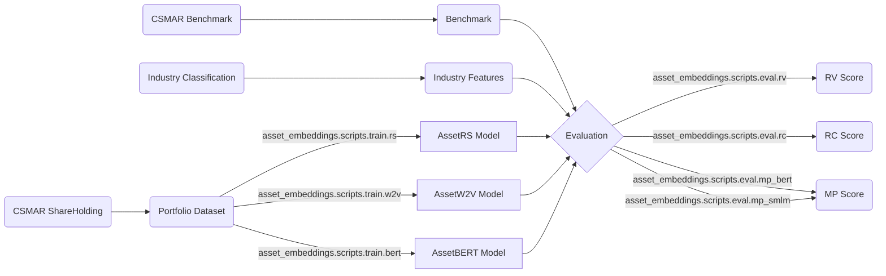

# Installation

> Part of [AssetEmbeddingsInChina](../index.md). See also [Training](train.md), [Evaluation](evaluate.md), [Run experiments](run-experiments.md).

## Prerequisites

- Python >= 3.12
- CUDA-compatible GPU (recommended)
- 6GB+ RAM for large-scale training

## Install with [uv](https://docs.astral.sh/uv/) (recommended)

```bash
git clone https://github.com/Initial-Singularity/AssetEmbeddingsInChina.git
cd AssetEmbeddingsInChina
uv sync
```

## Install with pip

```bash
git clone https://github.com/Initial-Singularity/AssetEmbeddingsInChina.git
cd AssetEmbeddingsInChina
pip install -e .
```

## Downloading the demo dataset

Production runs need CSMAR data. The data-preparation step is not part of this
repository; the inputs must follow the formats described in these docs (the
portfolio CSV in the [Datasets API](../reference/api/datasets.md)). For the
quickstart notebook you can use the bundled synthetic dataset under
`examples/data/`; no external data is required.

## Quickstart with presets

We provide presets for batch-generating configuration files, and hand-written
bash scripts for orchestrating experiment pipelines. For details on
preset-based config generation, see
[FastGenerator documentation](generate-configs.md).

```bash
# Linux/macOS — assumes the input data has been prepared in the documented formats
cd AssetEmbeddingsInChina

# Generate training configs from preset
uv run python -m scripts.tools.fast_generator config \
    -f templates/train_main.json
# Run pretrain + finetune
bash scripts/run/run_notify.sh scripts/run/train_main.sh

# Generate evaluation configs from preset
uv run python -m scripts.tools.fast_generator config \
    -f templates/eval_main.json
# Run evaluation
bash scripts/run/run_notify.sh scripts/run/eval_main.sh
```

## Execution framework

The runners under `scripts/run/` are executed through `run_notify.sh`, which adds marker filters (`-k` to include, `-e`/`--exclude` to skip; `-e` here is the wrapper's exclude, not the CLIs' `--experiment`), error limits and an e-mail on completion. `bash scripts/run/run_notify.sh -k bert scripts/run/train_main.sh` runs only the BERT jobs and `bash scripts/run/run_notify.sh -e rs -M 3 scripts/run/train_main.sh` skips the RS jobs and aborts after three failures. The whole contract, from the `job` markers to re-run lists built from the records database, is on [Run experiments](run-experiments.md).

## Project architecture overview

```
AssetEmbeddingsInChina/
├── asset_embeddings/         # Core framework
│   ├── configs/              # Config base class, ConfigField, constraints, per-task config classes
│   ├── modules/              # PyTorch modules: SimplifiedMLM and BertEmbeddings, a standalone copy of the HF BERT embedding layer that SimplifiedMLM uses
│   ├── records/              # Structured experiment records: record types, SQLite store, the Run object, read API
│   ├── trainers/             # Training classes: the masked-LM loop (AssetBERT, the two MP trainers), W2V and RS
│   ├── evaluators/           # RV / RC ridge benchmarks, grouped variants, label probe, pairwise similarity, MP score, data and estimation layers
│   ├── scripts/              # CLI entry points, run as python -m asset_embeddings.scripts.<group>.<name>
│   │   ├── train/            # bert, rs, w2v
│   │   └── eval/             # rv, rc, mp_bert, mp_smlm, rv_grouped, rc_grouped, label_probe, pairwise_similarity
│   ├── utils/                # Runtime helpers: seeding, memory, parsing, statistics
│   ├── datasets/             # Portfolio CSV format, PortfolioCorpus (CSR, memory-mapped disk version), MLM dataset and masking collator
│   ├── preparers.py          # Preparers for tokenizer, dataset, dataloader, accelerator, optimizer and models
│   └── logger.py             # Logging setup, error files under logs/error/
├── scripts/                  # Shell scripts and dev tools
│   ├── run/                  # Experiment runners (run_helper.sh, run_notify.sh, {train,eval}_<exp>.sh)
│   ├── ops/                  # Operational utilities
│   └── tools/                # fast_generator, runs_query, smtp
├── templates/                # Config presets expanded by fast_generator
├── examples/                 # Quickstart notebook
└── docs/                     # Developer guides and reproduction notes
```

### Data-flow pipeline


