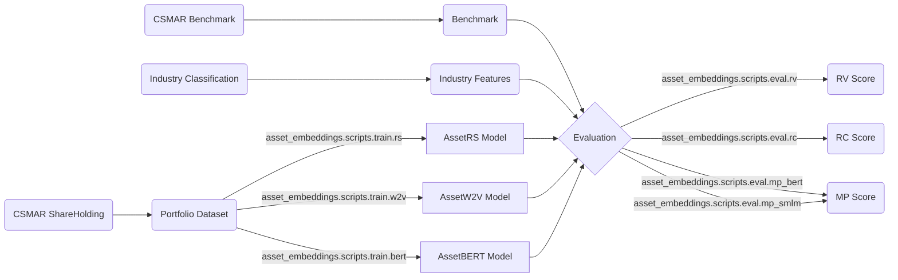

# 安装

> 隶属于 [AssetEmbeddingsInChina](../index.md)。另见 [训练](train.md)、[评估](evaluate.md)、[运行实验](run-experiments.md)。

## 前置条件

- Python >= 3.12
- 兼容 CUDA 的 GPU（推荐）
- 大规模训练需 6GB 以上内存

## 使用 [uv](https://docs.astral.sh/uv/) 安装（推荐）

```bash
git clone https://github.com/Initial-Singularity/AssetEmbeddingsInChina.git
cd AssetEmbeddingsInChina
uv sync
```

## 使用 pip 安装

```bash
git clone https://github.com/Initial-Singularity/AssetEmbeddingsInChina.git
cd AssetEmbeddingsInChina
pip install -e .
```

## 下载演示数据集

生产运行需要 CSMAR 数据。数据准备步骤不属于本仓库；输入须符合本文档描述的格式（组合 CSV 见 [数据集 API](../reference/api/datasets.md)）。对于快速上手 notebook，你可以使用 `examples/data/` 下随附的合成数据集，不需要任何外部数据。

## 用预设快速上手

我们提供了用于批量生成配置文件的预设（preset），以及用于编排实验流水线的手写 bash 脚本。基于预设的配置生成详情，参见 [FastGenerator 文档](generate-configs.md)。

```bash
# Linux/macOS —— 假设输入数据已按文档所述格式准备好
cd AssetEmbeddingsInChina

# 从预设生成训练配置
uv run python -m scripts.tools.fast_generator config \
    -f templates/train_main.json
# 运行预训练 + 微调
bash scripts/run/run_notify.sh scripts/run/train_main.sh

# 从预设生成评估配置
uv run python -m scripts.tools.fast_generator config \
    -f templates/eval_main.json
# 运行评估
bash scripts/run/run_notify.sh scripts/run/eval_main.sh
```

## 执行框架

`scripts/run/` 下的 runner 通过 `run_notify.sh` 执行，它附加标记过滤（`-k` 包含，`-e`/`--exclude` 排除；这里的 `-e` 是包装脚本的 exclude，不是各 CLI 的 `--experiment`）、错误上限与完成邮件。`bash scripts/run/run_notify.sh -k bert scripts/run/train_main.sh` 只运行 BERT 任务，`bash scripts/run/run_notify.sh -e rs -M 3 scripts/run/train_main.sh` 跳过 RS 任务并在三次失败后中止。从 `job` 标记到基于记录数据库构造重跑列表的完整约定，见 [运行实验](run-experiments.md)。

## 项目架构概览

```
AssetEmbeddingsInChina/
├── asset_embeddings/         # 核心框架
│   ├── configs/              # Config 基类、ConfigField、约束、各任务的配置类
│   ├── modules/              # PyTorch 模块：SimplifiedMLM 及其使用的 BertEmbeddings（HF BERT 嵌入层的独立副本）
│   ├── records/              # 结构化实验记录：记录类型、SQLite 存储、Run 对象、读取 API
│   ├── trainers/             # 训练类：掩码语言模型循环（AssetBERT、两个 MP 训练器）、W2V 与 RS
│   ├── evaluators/           # RV / RC ridge 基准、分组变体、标签探针、成对相似度、MP 分数、数据层与估计层
│   ├── scripts/              # CLI 入口，以 python -m asset_embeddings.scripts.<group>.<name> 运行
│   │   ├── train/            # bert、rs、w2v
│   │   └── eval/             # rv、rc、mp_bert、mp_smlm、rv_grouped、rc_grouped、label_probe、pairwise_similarity
│   ├── utils/                # 运行时辅助：随机种子、内存、解析、统计
│   ├── datasets/             # 组合 CSV 格式、PortfolioCorpus（CSR，可内存映射的磁盘版本）、MLM 数据集与遮蔽 collator
│   ├── preparers.py          # tokenizer / dataset / dataloader / accelerator / optimizer / 模型的 Preparer
│   └── logger.py             # 日志配置，错误文件写入 logs/error/
├── scripts/                  # Shell 脚本与开发工具
│   ├── run/                  # 实验 runner（run_helper.sh、run_notify.sh、{train,eval}_<exp>.sh）
│   ├── ops/                  # 运维工具
│   └── tools/                # fast_generator、runs_query、smtp
├── templates/                # 由 fast_generator 展开的配置预设
├── examples/                 # 快速上手 notebook
└── docs/                     # 开发指南与复现说明
```

### 数据流水线


