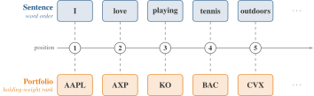
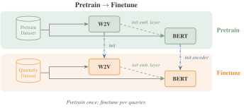

# AssetEmbeddingsInChina

> NLP-based asset embeddings for the Chinese A-share market.
> Companion code for the working paper **"Do Asset Embeddings Need Complete Holdings? Lessons from China"** (2026), [available on SSRN](https://papers.ssrn.com/sol3/papers.cfm?abstract_id=7690818).

Following [Gabaix et al. (2025)](https://papers.ssrn.com/sol3/papers.cfm?abstract_id=4507511), we treat each investor's portfolio as a *sentence* and each stock as a *token*: rank order carries economic meaning (the largest position is the primary exposure), just as word order carries meaning in language. This lets us learn asset representations with NLP techniques for asset pricing and investor modeling.

<p align="center"></p>

## What's new

Gabaix et al. estimate each quarter's embedding from that quarter's holdings alone. Because the demand system identifies an embedding only up to a rotation, quarters estimated separately need not share a coordinate frame, and the change $x_{a,t+1} - x_{a,t}$ can record a change of axes rather than a change in the asset. We pretrain Word2Vec and BERT once on the holdings through 2023Q1 (the first 80 % of holding observations) and finetune that shared base on each later quarter, so every quarter starts from the same coordinates: pretraining learns the structure common to all quarters, finetuning adds what is specific to each. BERT's embedding layer is also warm-started from the trained Word2Vec embedding at both stages, which gives thinly held assets a sensible starting point. Without pretraining, adjacent quarters differ by what amounts to a random rotation; with it, they stay in a common frame. See [Method & experiments](explanation/method.md#pretrainfinetune-paradigm).

<p align="center"></p>

## Quickstart

```bash
git clone https://github.com/Initial-Singularity/AssetEmbeddingsInChina
cd AssetEmbeddingsInChina
uv sync --extra notebook                      # notebook + ipykernel are demo-only extras
uv run jupyter lab examples/quickstart.ipynb  # or: uv run python examples/quickstart.py
```

The notebook runs the full chain of Word2Vec, BERT pretraining, BERT finetuning and the RV benchmark on a synthetic dataset shipped in `examples/data/` (CPU, ~1 minute). Real production runs require CSMAR data; the data-preparation step is not part of this repository, and the inputs must follow the formats described in these docs (the portfolio CSV in the [Datasets API](reference/api/datasets.md)). Full walkthrough: [Quickstart](tutorials/quickstart.md).

## Where to go

- **New here?** [Quickstart](tutorials/quickstart.md)
- **A recipe?** [Install](how-to/install.md) · [Train](how-to/train.md) · [Evaluate](how-to/evaluate.md)
- **The "why"?** [Method & experiments](explanation/method.md)
- **Just the embeddings?** Download them from Zenodo: [10.5281/zenodo.20640781](https://doi.org/10.5281/zenodo.20640781) (CC-BY-4.0)
- **Looking something up?** [CLI reference](reference/cli.md) · [API reference](reference/api/index.md)

## Citation

```bibtex
@unpublished{cheng2026asset,
  title  = {Do Asset Embeddings Need Complete Holdings? Lessons from China},
  author = {Cheng, Zitong and Huang, Dashan and Liu, Xiaobin and Zeng, Tao},
  year   = {2026},
  note   = {Working paper, available at SSRN},
  url    = {https://papers.ssrn.com/sol3/papers.cfm?abstract_id=7690818},
}
```

The trained embeddings are archived on Zenodo (CC-BY-4.0): [10.5281/zenodo.20640781](https://doi.org/10.5281/zenodo.20640781).
