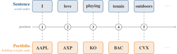
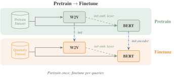

# AssetEmbeddingsInChina

> 面向中国 A 股市场的、基于 NLP 的资产嵌入（asset embeddings）。
> 配套工作论文 **"Do Asset Embeddings Need Complete Holdings? Lessons from China"**（2026）的代码。

沿用 [Gabaix et al. (2025)](https://papers.ssrn.com/sol3/papers.cfm?abstract_id=4507511) 的思路，我们把每个投资者的投资组合视为一个*句子*，把每只股票视为一个*词元（token）*：持仓的排序携带经济含义（最大的仓位即首要敞口），正如语言中词序携带语义一样。由此即可用 NLP 技术学习资产表示，用于资产定价与投资者建模。

<p align="center"></p>

## 新意何在

Gabaix et al. 只用当季持仓估计该季度的嵌入。需求系统只在旋转意义下识别嵌入，因此各季度分别估计时未必处在同一坐标系中，差值 $x_{a,t+1} - x_{a,t}$ 记录的可能是坐标轴的变化，而不是资产本身的变化。我们在截至 2023Q1 的持仓（前 80 % 的持仓观测）上一次性预训练 Word2Vec 与 BERT，再在此后每个季度上对这一共同的基础模型做微调，使每个季度都从同一套坐标出发：预训练学习各季度共有的结构，微调补充各季度特有的部分。BERT 的嵌入层在两个阶段都以训练好的 Word2Vec 嵌入热启动，为持有者很少的资产提供合理的起点。不做预训练时，相邻季度之间的差别相当于一次随机旋转；做了预训练，它们保持在同一坐标系中。见 [方法与实验](explanation/method.md#预训练-微调范式)。

<p align="center"></p>

## 快速上手

```bash
git clone https://github.com/Initial-Singularity/AssetEmbeddingsInChina
cd AssetEmbeddingsInChina
uv sync --extra notebook                      # notebook 与 ipykernel 仅为演示用的可选依赖
uv run jupyter lab examples/quickstart.ipynb  # 或：uv run python examples/quickstart.py
```

该 notebook 在 `examples/data/` 中随附的合成数据集上跑完整条流程：Word2Vec、BERT 预训练、BERT 微调，再到 RV 基准（CPU，约 1 分钟）。真实的生产运行需要 CSMAR 数据；数据准备步骤不属于本仓库，输入须符合本文档描述的格式（组合 CSV 见 [数据集 API](reference/api/datasets.md)）。完整走查：[快速上手教程](tutorials/quickstart.md)。

## 该往哪儿看

- **初次到访？** [快速上手](tutorials/quickstart.md)
- **找操作配方？** [安装](how-to/install.md) · [训练](how-to/train.md) · [评估](how-to/evaluate.md)
- **想知道“为什么”？** [方法与实验](explanation/method.md)
- **只想要 embedding？** 从 Zenodo 下载：[10.5281/zenodo.20640781](https://doi.org/10.5281/zenodo.20640781)（CC-BY-4.0）
- **查点东西？** [CLI 参考](reference/cli.md) · [API 参考](reference/api/index.md)

## 引用

```bibtex
@unpublished{cheng2026asset,
  title  = {Do Asset Embeddings Need Complete Holdings? Lessons from China},
  author = {Cheng, Zitong and Huang, Dashan and Liu, Xiaobin and Zeng, Tao},
  year   = {2026},
  note   = {Working paper},
}
```

训练好的 embedding 已在 Zenodo 存档（CC-BY-4.0）：[10.5281/zenodo.20640781](https://doi.org/10.5281/zenodo.20640781)。
